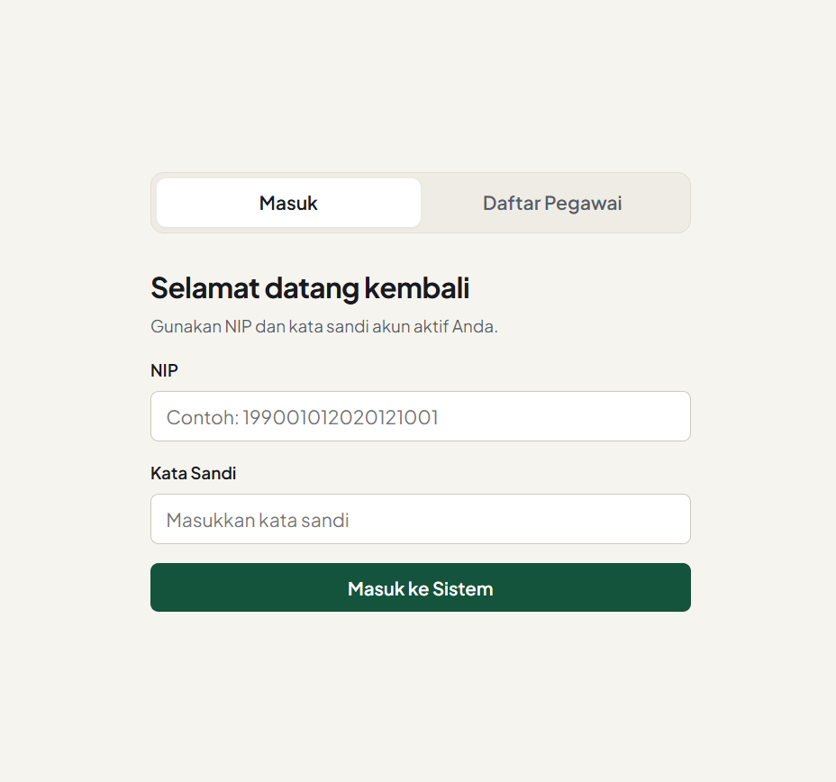
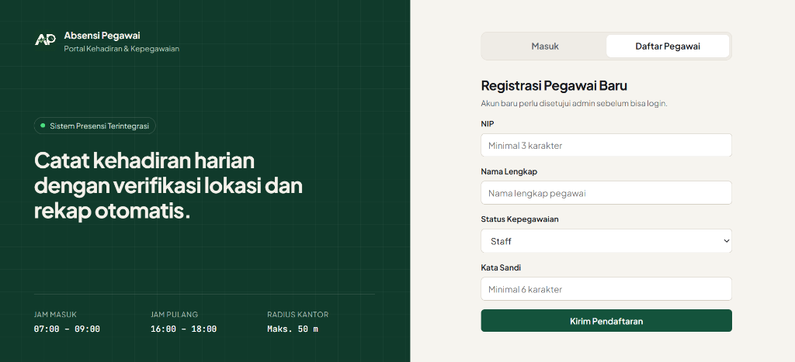
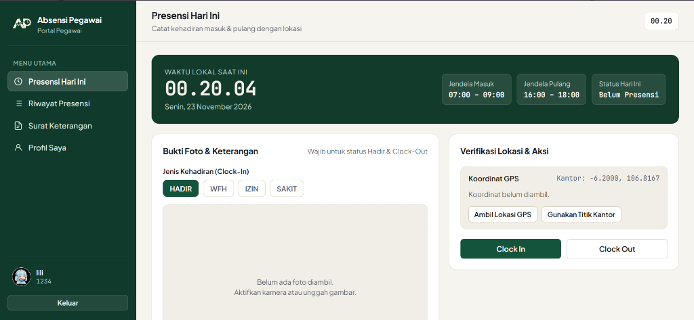
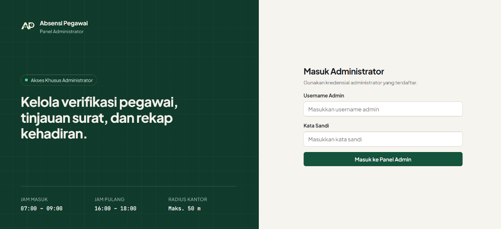
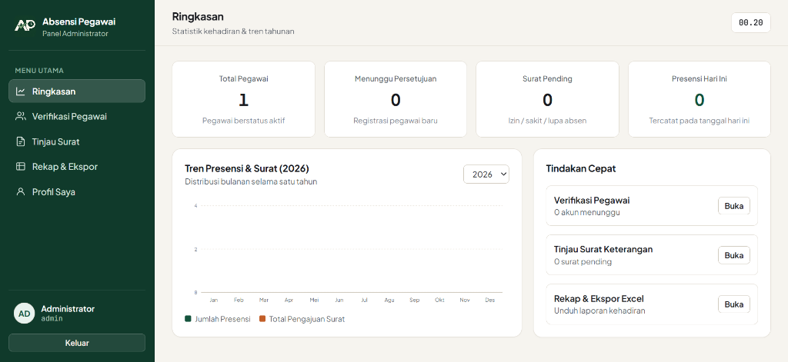

# Absensi Pegawai

Aplikasi web sistem presensi pegawai berbasis **FastAPI** (backend) dan **Vanilla ES6+** (frontend) untuk pencatatan kehadiran harian dengan verifikasi foto & lokasi GPS, pengajuan surat keterangan, persetujuan kepegawaian, serta rekap dan ekspor Excel.

## Fitur Utama

### Portal Pegawai (`/`)
- **Registrasi & Login Pegawai** menggunakan NIP, kata sandi, dan status kepegawaian (`staff` / `magang`).
- **Presensi Masuk & Pulang**:
  - Pilihan status kehadiran (`hadir`, `wfh`, `izin`, `sakit`).
  - Pengambilan foto langsung dari kamera atau unggah gambar.
  - Verifikasi koordinat GPS dengan perhitungan jarak otomatis (Haversine) terhadap titik kantor.
- **Riwayat Presensi**: Daftar catatan clock-in, clock-out, jarak, dan catatan harian.
- **Surat Keterangan**: Pengajuan `izin`, `sakit`, atau `lupa` beserta pelacakan status tinjauan admin (`pending`, `diterima`, `ditolak`).
- **Profil Saya**: Pembaruan nama lengkap, status kepegawaian, divisi, dan unggah foto profil langsung.

### Portal Administrator (`/admin`)
- **Ringkasan Dashboard**: Statistik pegawai aktif, akun menunggu verifikasi, surat pending, presensi hari ini, dan grafik tren 12 bulan.
- **Verifikasi Pegawai**: Menyetujui (`aktif`) atau menolak (`ditolak`) pendaftaran akun baru.
- **Tinjauan Surat Keterangan**: Menyetujui atau menolak pengajuan surat beserta catatan review.
- **Rekap & Ekspor Excel**: Filter rekap presensi berdasarkan bulan, tahun, nama, dan status kepegawaian, serta unduh laporan `.xlsx`.

---

## Struktur Proyek

```text
absensi-app/
├── backend/
│   ├── alembic/             # Migrasi database Alembic
│   ├── app/
│   │   ├── models/          # Model SQLAlchemy (User, Absensi, SuratKeterangan)
│   │   ├── schemas/         # Skema validasi Pydantic
│   │   ├── services/        # Keamanan JWT & utilitas presensi
│   │   ├── config.py        # Konfigurasi environment
│   │   ├── database.py      # Koneksi SQLAlchemy
│   │   └── main.py          # Aplikasi FastAPI & static serving frontend
│   ├── tests/               # Pengujian pytest
│   ├── .env.example         # Contoh konfigurasi environment
│   └── requirements.txt     # Dependensi Python
├── frontend/
│   ├── assets/              # Logo aplikasi
│   ├── js/
│   │   ├── views/           # Halaman Auth, Pegawai, dan Admin
│   │   ├── api.js           # Wrapper fetch API & ekspor Excel
│   │   ├── components.js    # Komponen UI, modal, toast, grafik SVG
│   │   └── app.js           # Router & shell utama
│   ├── index.html
│   └── styles.css
├── docs/
│   └── screenshots/         # Dokumentasi tampilan aplikasi
├── .gitignore
└── README.md
```

---

## Cara Menjalankan di Lokal

1. Masuk ke folder `backend`:
   ```bash
   cd backend
   ```

2. Buat dan aktifkan virtual environment, lalu pasang dependensi:
   ```bash
   python -m venv venv
   # Windows (PowerShell)
   .\venv\Scripts\Activate.ps1
   pip install -r requirements.txt
   ```

3. Salin `.env.example` menjadi `.env` dan sesuaikan nilainya:
   ```bash
   copy .env.example .env
   ```
   Variabel penting di `.env`:
   - `DATABASE_URL` (default: `sqlite:///./dev.db`)
   - `JWT_SECRET_KEY`
   - `OFFICE_LAT`, `OFFICE_LONG`, `MAX_DISTANCE_METERS`
   - `CLOCK_IN_START`, `CLOCK_IN_END`, `CLOCK_OUT_START`, `CLOCK_OUT_END`
   - `ADMIN_NIP`, `ADMIN_PASSWORD`, `ADMIN_NAME`

4. Jalankan server:
   ```bash
   python -m uvicorn app.main:app --host 127.0.0.1 --port 8000
   ```

5. Akses aplikasi melalui browser:
   - **Portal Pegawai**: `http://127.0.0.1:8000/`
   - **Portal Administrator**: `http://127.0.0.1:8000/admin`
   - **Swagger UI (Dokumentasi API)**: `http://127.0.0.1:8000/docs`

---

## Dokumentasi Tampilan

### 1. Halaman Masuk Pegawai (`/`)
Halaman autentikasi khusus pegawai menggunakan **NIP** dan **Kata Sandi**. Portal pegawai terpisah sepenuhnya dari portal administrator sehingga pegawai tidak melihat maupun mengakses menu admin.



### 2. Registrasi Pegawai Baru (`/`)
Tab **Daftar Pegawai** untuk pendaftaran akun baru dengan mengisi NIP, Nama Lengkap, Status Kepegawaian (`Staff` atau `Magang`), dan Kata Sandi. Akun yang baru mendaftar berstatus `pending` dan perlu disetujui admin sebelum dapat digunakan untuk login.



### 3. Portal Pegawai — Presensi Hari Ini (`/`)
Ruang kerja utama pegawai setelah login:
- Menampilkan jam lokal *real-time*, jendela jam masuk (`07:00 – 09:00`), jam pulang (`16:00 – 18:00`), dan status presensi hari ini.
- Mendukung pilihan status kehadiran (`HADIR`, `WFH`, `IZIN`, `SAKIT`), pengambilan foto bukti lewat kamera atau unggah file, serta verifikasi koordinat GPS terhadap titik kantor (maksimal radius `50 m`) sebelum melakukan **Clock In** atau **Clock Out**.
- Sidebar kiri juga menyediakan akses ke **Riwayat Presensi**, **Surat Keterangan**, dan **Profil Saya** (termasuk klik langsung pada kartu profil di kiri bawah).



### 4. Halaman Masuk Administrator (`/admin`)
Portal login terpisah khusus untuk administrator menggunakan kredensial admin yang terdaftar. Akun pegawai biasa akan ditolak apabila mencoba masuk melalui rute `/admin`.



### 5. Panel Administrator — Ringkasan (`/admin`)
Dashboard pemantauan untuk admin yang menampilkan:
- **Kartu KPI**: Total Pegawai (berstatus aktif), Menunggu Persetujuan, Surat Pending, dan Presensi Hari Ini.
- **Grafik Tren Tahunan**: Distribusi jumlah presensi dan total pengajuan surat per bulan dalam satu tahun.
- **Tindakan Cepat**: Pintasan langsung ke halaman **Verifikasi Pegawai**, **Tinjau Surat Keterangan**, serta **Rekap & Ekspor Excel**.


